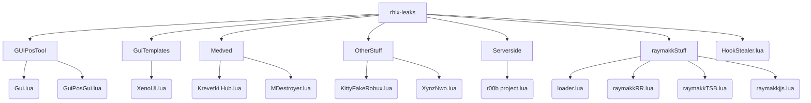

["['# rblx-leaks\\n\\nPersonal archive of deobfuscated and dumped Roblox Lua scripts found on various forums.\\nMostly doing this for fun, Repo also contains a  random UI templates and small utility scripts I wrote or messed around with.\\n\\n', '\\n<!-- GRAPH:END -->\\n']", "\n```mermaid\ngraph TD\n    Root[rblx-leaks]\n    Root --> dir_1[GUIPosTool]\n    dir_1 --> file_2(Gui.lua)\n    dir_1 --> file_3(GuiPosGui.lua)\n    Root --> dir_4[GuiTemplates]\n    dir_4 --> file_5(XenoUI.lua)\n    Root --> dir_6[Medved]\n    dir_6 --> file_7(Krevetki Hub.lua)\n    dir_6 --> file_8(MDestroyer.lua)\n    Root --> dir_9[OtherStuff]\n    dir_9 --> file_10(KittyFakeRobux.lua)\n    dir_9 --> file_11(XynzNwo.lua)\n    Root --> dir_12[Serverside]\n    dir_12 --> file_13(r00b project.lua)\n    Root --> dir_14[raymakkStuff]\n    dir_14 --> file_15(loader.lua)\n    dir_14 --> file_16(raymakkRR.lua)\n    dir_14 --> file_17(raymakkTSB.lua)\n    dir_14 --> file_18(raymakkjjs.lua)\n    Root --> file_19(HookStealer.lua)\n```\n<!-- GRAPH:END -->['# rblx-leaks\\n\\nPersonal archive of deobfuscated and dumped Roblox Lua scripts found on various forums.\\nMostly doing this for fun, Repo also contains a  random UI templates and small utility scripts I wrote or messed around with.\\n\\n", "\\n', '\\n']"]<!-- GRAPH:START -->

<!-- GRAPH:END -->["['# rblx-leaks\\n\\nPersonal archive of deobfuscated and dumped Roblox Lua scripts found on various forums.\\nMostly doing this for fun, Repo also contains a  random UI templates and small utility scripts I wrote or messed around with.\\n\\n', '\\n", "\\n']<!-- GRAPH:START -->\n```mermaid\ngraph TD\n    Root[rblx-leaks]\n    Root --> dir_1[GUIPosTool]\n    dir_1 --> file_2(Gui.lua)\n    dir_1 --> file_3(GuiPosGui.lua)\n    Root --> dir_4[GuiTemplates]\n    dir_4 --> file_5(XenoUI.lua)\n    Root --> dir_6[Medved]\n    dir_6 --> file_7(Krevetki Hub.lua)\n    dir_6 --> file_8(MDestroyer.lua)\n    Root --> dir_9[OtherStuff]\n    dir_9 --> file_10(KittyFakeRobux.lua)\n    dir_9 --> file_11(XynzNwo.lua)\n    Root --> dir_12[Serverside]\n    dir_12 --> file_13(r00b project.lua)\n    Root --> dir_14[raymakkStuff]\n    dir_14 --> file_15(loader.lua)\n    dir_14 --> file_16(raymakkRR.lua)\n    dir_14 --> file_17(raymakkTSB.lua)\n    dir_14 --> file_18(raymakkjjs.lua)\n    Root --> file_19(HookStealer.lua)\n```\n", "['# rblx-leaks\\n\\nPersonal archive of deobfuscated and dumped Roblox Lua scripts found on various forums.\\nMostly doing this for fun, Repo also contains a  random UI templates and small utility scripts I wrote or messed around with.\\n\\n<!-- GRAPH:START -->\\n', '\\n']"]