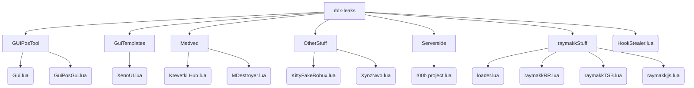

# rblx-leaks

Personal archive of deobfuscated and dumped Roblox Lua scripts found on various forums. Mostly doing this for fun, Repo also contains a random UI templates and small utility scripts I wrote or messed around with.

<!-- GRAPH:START -->

<!-- GRAPH:END -->
